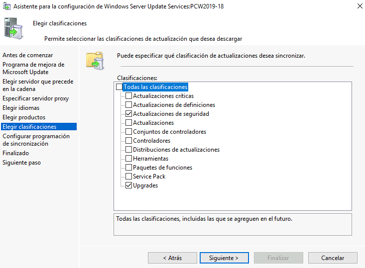
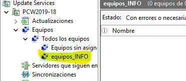
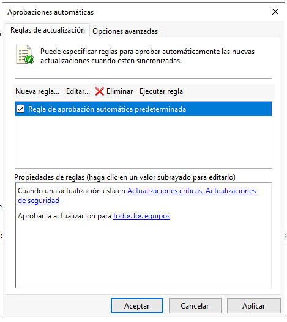
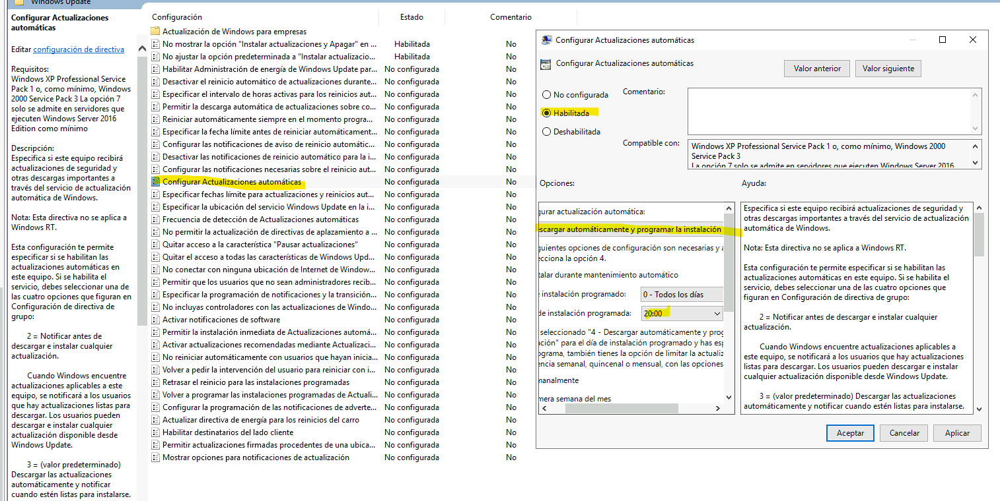
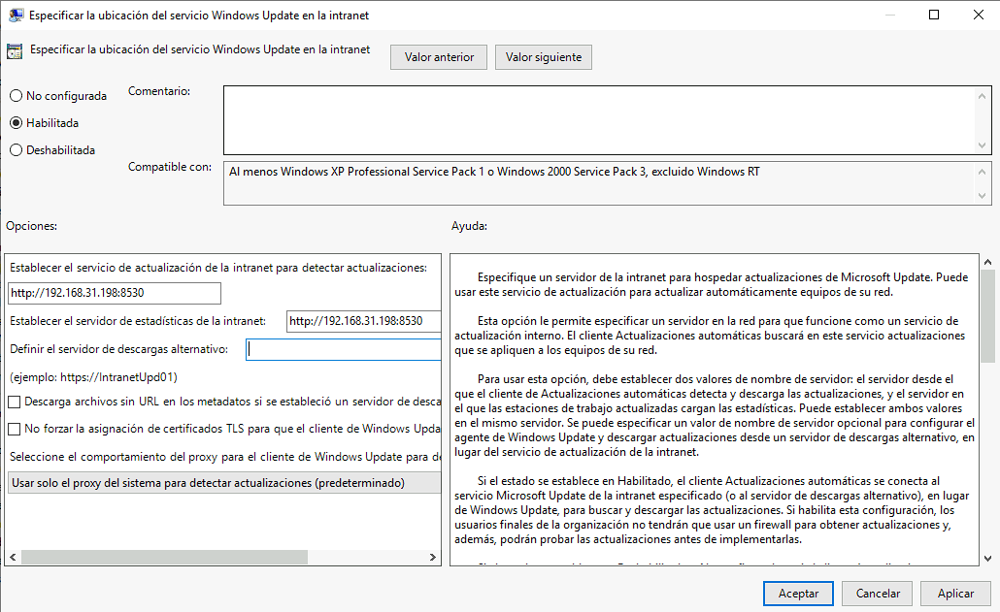
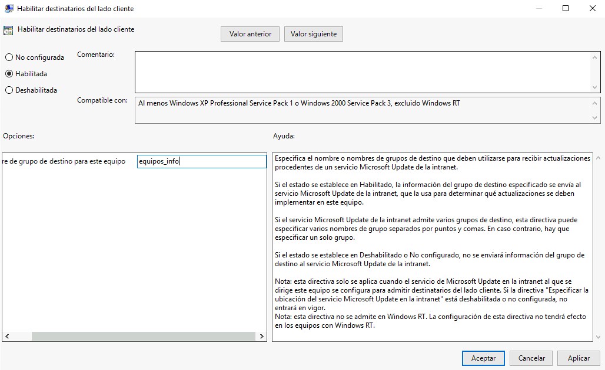
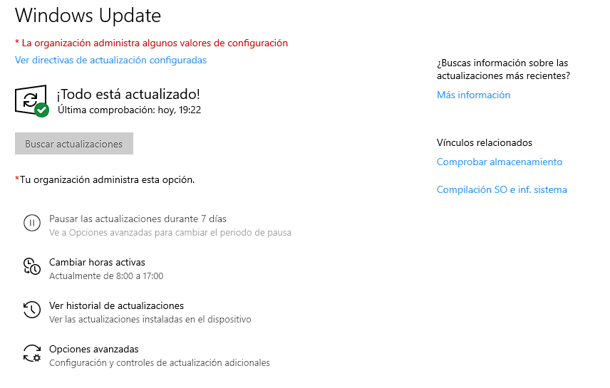

# WSUS: actualizaciones de Windows centralizadas

WSUS (Windows Server Update Services) descarga las actualizaciones de Microsoft
una sola vez y las reparte a los equipos del dominio. Así se decide qué se
instala y cuándo, y no salen todos los equipos a internet a bajarse lo mismo.

Montado en Windows Server 2019 con Active Directory, y un cliente Windows 10
unido al dominio.

## 1. Preparar el servidor

Actualizar primero el propio servidor desde PowerShell:

```powershell
Install-Module PSWindowsUpdate
Import-Module PSWindowsUpdate
Get-WindowsUpdate
Install-WindowsUpdate
```

Para los informes de la consola de WSUS hacen falta dos paquetes, en este orden:
`SQLSysClrTypes.msi` y después **Microsoft Report Viewer Redistributable 2012**.

## 2. Instalar el rol

Administrador del servidor → Agregar roles y características → **Windows Server
Update Services**, con estos servicios de rol:

- **WID Connectivity**: la base de datos interna de Windows. Para un solo
  servidor sobra, no hace falta SQL Server.
- **WSUS Services**.

Como ubicación del contenido, una carpeta propia: `C:\WSUS`. Ahí se guardan las
actualizaciones descargadas, así que conviene que tenga espacio.

## 3. Asistente de configuración

| Paso | Qué elegí | Por qué |
|---|---|---|
| Servidor de origen | Microsoft Update | No hay otro WSUS por encima |
| Proxy | Sin proxy | |
| Idiomas | Español (después añadí inglés) | Cada idioma multiplica lo que se descarga |
| Productos | Solo la versión de Windows 10 de los clientes | Lo mismo: descargar solo lo que se va a usar |
| Clasificaciones | Actualizaciones de seguridad y Upgrades | |
| Sincronización | Automática, una vez al día | |



Después de la primera sincronización, en **Sincronizaciones** se ve cuándo
terminó cada una, si dio error y un informe con el detalle.

## 4. Grupo de equipos y aprobaciones

**Equipos → Todos los equipos → Agregar grupo de equipos**: `equipos_INFO`. En una
empresa se haría uno por departamento, o uno de pruebas y otro para el resto.



En **Opciones → Equipos**, marcar **Usar directivas de grupo**: así es la GPO la
que mete a cada equipo en su grupo, y no hay que moverlos a mano.

WSUS solo instala lo que está **aprobado**. En **Opciones → Aprobaciones
automáticas** activé la regla predeterminada, que aprueba sola las
actualizaciones críticas y de seguridad.



Ojo: esa regla aprueba para **todos los equipos**, no solo para `equipos_INFO`.
Para aprobar primero en un grupo de prueba habría que crear una regla propia.

## 5. La directiva de grupo

En Active Directory, una unidad organizativa con los equipos que se van a
actualizar desde WSUS. Sobre ella, en Administración de directivas de grupo, una
GPO nueva: `ActualizaWSUS`.

Configuración del equipo → Directivas → Plantillas administrativas → Componentes
de Windows → **Windows Update**:

| Directiva | Valor |
|---|---|
| No mostrar "Instalar actualizaciones y apagar" | Habilitada |
| No ajustar la opción predeterminada a "Instalar actualizaciones y apagar" | Habilitada |
| Configurar actualizaciones automáticas | 4: descargar y programar la instalación, todos los días a las 20:00 |
| Especificar la ubicación del servicio Windows Update en la intranet | `http://IP-DEL-SERVIDOR:8530` en los dos campos |
| Habilitar destinatarios del lado cliente | `equipos_INFO` |
| Volver a programar las instalaciones programadas | Habilitada |
| No reiniciar automáticamente con usuarios que hayan iniciado sesión | Habilitada |



La más importante es la de la **ubicación en la intranet**: es la que hace que el
equipo deje de ir a Microsoft y le pida las actualizaciones al WSUS. 8530 es el
puerto HTTP por defecto de WSUS.



**Destinatarios del lado cliente** es la que mete al equipo en el grupo de WSUS.
El nombre tiene que coincidir con el del grupo creado en la consola.



## 6. Comprobarlo en el cliente

```powershell
gpupdate /force
```

En Windows Update aparece "La organización administra algunos valores de
configuración", señal de que la GPO se ha aplicado, y al buscar actualizaciones
las pide al WSUS.



En la consola de WSUS, el equipo aparece dentro de `equipos_INFO` con sus
actualizaciones pendientes.

## 7. Mantenimiento

- **Opciones → Asistente para la limpieza del servidor**: borra actualizaciones
  reemplazadas o rechazadas y equipos que ya no se conectan. Sin esto, `C:\WSUS`
  crece sin parar.
- **Opciones → Notificaciones por correo electrónico**: avisos de nuevas
  actualizaciones e informes de estado, con el servidor SMTP, puerto y remitente.
