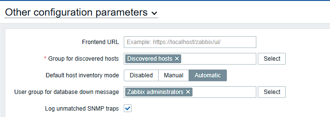
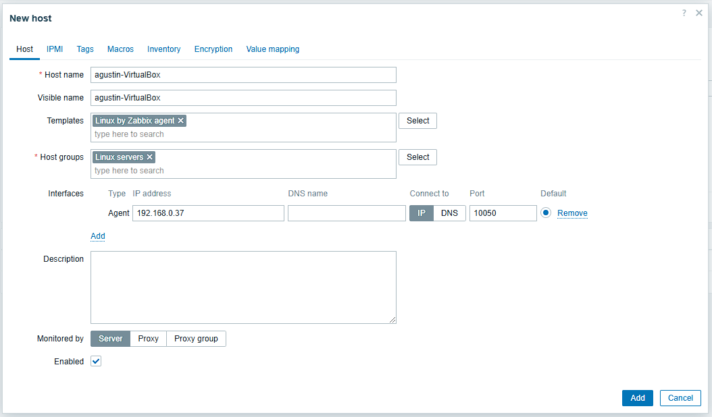
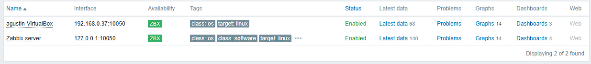
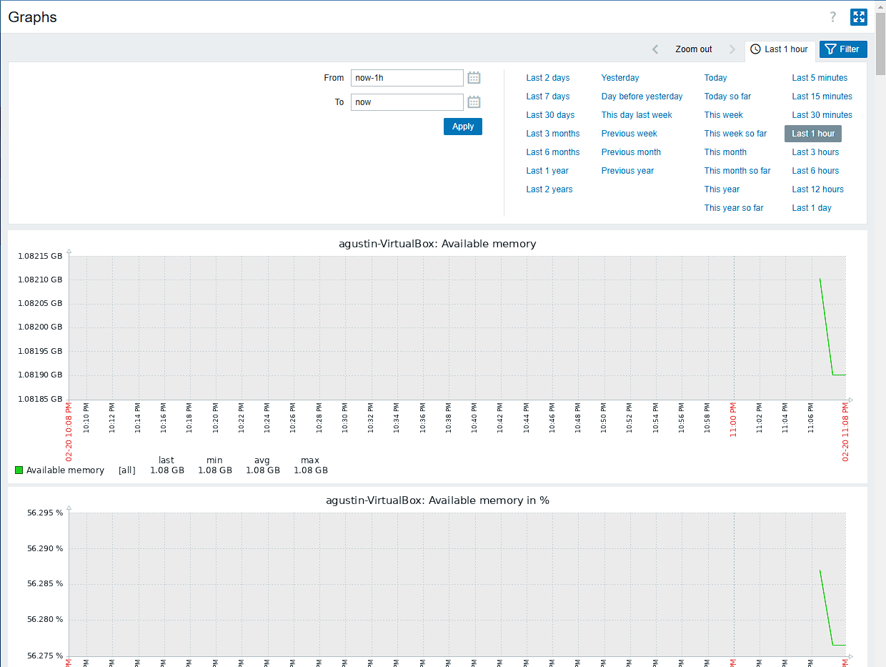

# Zabbix: monitorización de servidores

Zabbix vigila servidores, redes y servicios: recoge datos (CPU, memoria, disco,
red...), los dibuja en gráficas y avisa cuando algo se sale de lo normal.

Montado con Zabbix 7.2 sobre Ubuntu 22.04, con MySQL y Apache, y un segundo
Ubuntu como equipo vigilado.

## 1. Servidor

En la [página de descargas de Zabbix](https://www.zabbix.com/download) se elige
versión, sistema, componentes (server, frontend y agent), base de datos (MySQL) y
servidor web (Apache), y da los comandos exactos. Para esta combinación:

```bash
# Repositorio de Zabbix
wget https://repo.zabbix.com/zabbix/7.2/release/ubuntu/pool/main/z/zabbix-release/zabbix-release_latest_7.2+ubuntu22.04_all.deb
sudo dpkg -i zabbix-release_latest_7.2+ubuntu22.04_all.deb
sudo apt update

# Servidor, interfaz web, configuración de Apache, esquema de la base de datos y agente
sudo apt install zabbix-server-mysql zabbix-frontend-php zabbix-apache-conf zabbix-sql-scripts zabbix-agent

# Base de datos
sudo apt install mysql-server
```

## 2. Base de datos

```sql
-- sudo mysql -uroot -p
create database zabbix character set utf8mb4 collate utf8mb4_bin;
create user zabbix@localhost identified by 'CONTRASEÑA';
grant all privileges on zabbix.* to zabbix@localhost;
set global log_bin_trust_function_creators = 1;
quit;
```

Importar el esquema y los datos iniciales:

```bash
zcat /usr/share/zabbix/sql-scripts/mysql/server.sql.gz | mysql --default-character-set=utf8mb4 -uzabbix -p zabbix
```

Y volver a desactivar la opción:

```sql
set global log_bin_trust_function_creators = 0;
```

`log_bin_trust_function_creators` hace falta porque el esquema de Zabbix crea
funciones, y MySQL no deja crearlas a un usuario sin privilegios especiales
mientras tiene activado el registro binario. Se activa solo para la importación y
se apaga después: dejarlo activado es un riesgo.

## 3. Arrancar

En `/etc/zabbix/zabbix_server.conf`, la contraseña de la base de datos:

```
DBPassword=CONTRASEÑA
```

```bash
sudo systemctl restart zabbix-server zabbix-agent apache2
sudo systemctl enable zabbix-server zabbix-agent apache2
```

El resto se hace desde el navegador, en `http://IP-DEL-SERVIDOR/zabbix`: idioma,
comprobación de requisitos, conexión con la base de datos y nombre del servidor.
El usuario inicial es `Admin` con contraseña `zabbix`; lo primero, cambiarla.

## 4. Agente en el equipo a vigilar

Mismo repositorio que en el servidor, y solo el agente:

```bash
sudo apt install zabbix-agent
```

En `/etc/zabbix/zabbix_agentd.conf`:

```
Server=192.168.0.33         # IP del servidor Zabbix: quién puede pedirle datos
ServerActive=192.168.0.33   # a quién le manda datos el agente por su cuenta
Hostname=nombre-del-equipo  # tiene que coincidir con el nombre que se le da en Zabbix
```

```bash
sudo systemctl restart zabbix-agent
sudo systemctl enable zabbix-agent
sudo ufw allow 10050        # puerto en el que escucha el agente
```

En mi caso, el `ufw enable` que hice antes se canceló y el cortafuegos se quedó
desactivado, así que la regla del 10050 no llegó a hacer falta. Con `ufw` activo,
sin esa regla el servidor no puede hablar con el agente.

## 5. Inventario automático

Por defecto el inventario de los equipos está desactivado. En **Administration →
General → Other**, **Default host inventory mode: Automatic**: Zabbix rellena solo
los datos de cada equipo (sistema, hardware...) con lo que le da el agente.



## 6. Dar de alta el equipo

**Data collection → Hosts → Create host**:

- **Host name**: el mismo que `Hostname` en el agente.
- **Templates**: `Linux by Zabbix agent`, que trae ya los datos a recoger
  (CPU, memoria, disco, red...) y las alertas.
- **Host groups**: `Linux servers`.
- **Interfaces**: Agent, con la IP del equipo y el puerto 10050.



Si la conexión funciona, la etiqueta **ZBX** se pone en verde:



Desde el menú del equipo, **Graphs** muestra los datos que va recogiendo:



## Pendiente

- Configurar alertas por correo o Telegram cuando salte un problema.
- Usar una regla de descubrimiento de red (**Discovery**) para que Zabbix
  encuentre y dé de alta los equipos solo, en vez de uno por uno.
